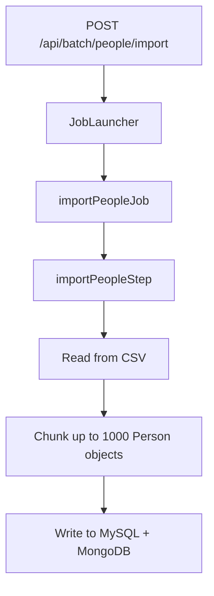

# How the People Import Batch Works

Think of Spring Batch as a **factory line** that moves data from a **file** into **two databases**, in **batches of 1,000 rows**, and only when you **press a button** (the REST API).

## The big picture

| Piece in plain English | In this project |
|------------------------|-----------------|
| **Button** | `POST /api/batch/people/import` |
| **The whole task** | Job named `importPeopleJob` |
| **One stage of the line** | Step `importPeopleStep` |
| **Where rows come from** | CSV file `people-10000-dummy-data.csv` |
| **One row as a Java object** | `Person` |
| **Where rows go** | MySQL table `People` + MongoDB collection `People` |
| **Batch size** | 1,000 people at a time |

## Step 1: You start the app

`SpringBatchApplication` is a normal Spring Boot app. It starts Tomcat on port 8080 and wires everything together (database connections, batch machinery, your controller, your job config).

**Important:** With `spring.batch.job.enabled=false`, the import **does not** run by itself. Nothing happens until you call the API.

## Step 2: You call the REST API

```http
POST http://localhost:8080/api/batch/people/import
```

`BatchJobController` receives that request. It asks **`JobLauncher`** to run the job named **`importPeopleJob`**.

- **`Job`** = the recipe (“import people from CSV”).
- **`JobLauncher`** = the worker that actually starts that recipe.
- **`JobParameters`** = small inputs for this run (the job also uses `RunIdIncrementer` so each run gets a new `run.id` — like a run number).

The HTTP call **waits** until the job finishes, then returns something like job id and `COMPLETED` (or an error).

## Step 3: What is a Job vs a Step?

Spring Batch uses a simple hierarchy:



- **Job** = whole import from start to finish.
- **Step** = the real work (read → write); in this project there is only one step.

## Step 4: The step — read, chunk, write

`PeopleImportJobConfig` defines the step with **chunk size 1000**. That means:

1. **Read** up to 1,000 rows from the CSV.
2. **Write** all 1,000 to MySQL and MongoDB together (as one chunk).
3. Repeat until the file is empty.

For 10,000 rows you get **10 chunks**, not 10,000 separate tiny writes.

### Reader (`peopleReader`)

- Opens the CSV from `src/main/resources`.
- Skips the **header line**.
- Parses each line into a **`Person`** object (name, email, birthday, etc.).
- Handles quoted fields (e.g. job titles with commas).

### Writer (`peopleWriter`)

This is a **composite** writer — one writer that calls **two** writers:

1. **`mysqlPeopleWriter`** — bulk `INSERT` into MySQL `People`.
2. **`mongoPeopleWriter`** — saves the same people into MongoDB collection `People`.

So every chunk is written to **both** databases.

### Transaction note

The chunk uses the **MySQL** transaction manager. If the MySQL insert for a chunk fails, that chunk can roll back in MySQL. MongoDB is **not** part of that same transaction, so in a failure scenario the two databases could theoretically get out of sync. For learning and demos this is usually acceptable.

## Step 5: What is `Person`?

`Person` is a **Java bag of fields** that matches one CSV row. It is used for:

- Reading from the file
- Inserting into MySQL (property names map to SQL parameters)
- Storing in MongoDB (`@Document(collection = "People")`)

## Step 6: What does Spring Batch store in MySQL besides your data?

Besides the `practice.People` table, Spring Batch uses **its own tables** in the same database (JDBC batch metadata). Those tables remember things like:

- Did this job run before?
- Did step 3 of 10 finish?
- Can we restart after a crash?

`spring.batch.jdbc.initialize-schema=always` tells Boot to create those tables for you.

## End-to-end in one sentence

**You POST to the API → Spring starts `importPeopleJob` → one step reads the CSV in chunks of 1,000 `Person` objects and writes each chunk to MySQL and MongoDB → the API responds when it is done.**

## Mental model (cheat sheet)

| Term | Remember as |
|------|----------------|
| **ItemReader** | “Get next item from source” |
| **ItemWriter** | “Save items to destination” |
| **Chunk** | “Process N items, then commit as a group” |
| **Job** | “The full workflow” |
| **Step** | “One phase of the workflow” |
| **JobLauncher** | “Start the job now” |

## Key source files

| File | Role |
|------|------|
| `BatchJobController.java` | REST endpoint that launches the job |
| `PeopleImportJobConfig.java` | Job, step, reader, writers, chunk size |
| `Person.java` | Model for one CSV row / one DB record |
| `people-10000-dummy-data.csv` | Input data |
| `application.properties` | MySQL, MongoDB, batch settings |
| `sql/create-people-table.sql` | MySQL DDL for `People` |

## Databases

- **MySQL:** `localhost:3306`, schema `practice`, table `People`
- **MongoDB:** `localhost:27017`, database `practice`, collection `People`
